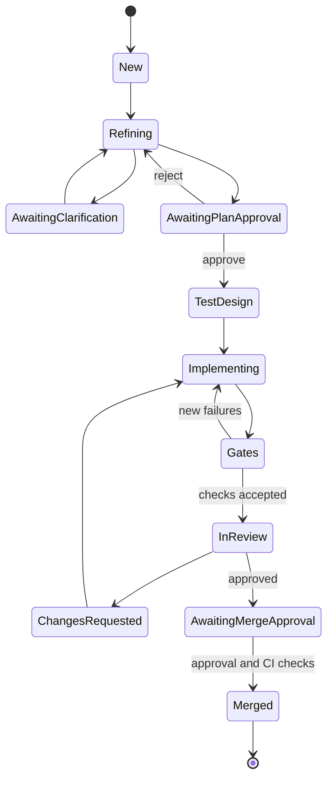

# Architecture

Devflow combines a deterministic execution engine with agents at the points that need judgment.
The repository configuration, persisted ticket state and verified gate results determine when
work advances. An agent saying it is finished does not itself advance a ticket.

## Components

| Component | Responsibility |
|---|---|
| `init.py`, `detect.py`, `config.py` | Discover projects and render per-repository configuration, prompts and schemas |
| `loadconfig.py` | Validate runtime settings from the primary checkout |
| `states.py`, `store.py` | Legal transitions, retry caps, transactional ticket state, events and artifacts |
| `scheduler.py`, `board.py` | Select eligible GitHub Project items and mirror ticket status |
| `runner.py` | Sequential queue execution, polling, exclusive ownership and stage-boundary limits |
| `engine.py` | Drive a ticket through its stages and human gates |
| `agents/`, `router.py` | Invoke coding-agent CLIs and OpenClaw, normalize output, resume sessions and route work |
| `worktree.py`, `gitops.py` | Manage checkouts, commits, branch pushes and remote verification |
| `gates.py`, `baseline.py`, `diffguard.py` | Execute checks, distinguish existing failures, detect protected-file or test changes |
| `host.py`, `commands.py`, `notify.py` | GitHub operations, authorized human commands and configurable notifications |
| `graphctx.py`, `context.py` | Refresh local Graphify data and construct repository context |
| `learn/` | Capture run records, distil and manage lessons, select prompt context and publish context PRs |

## Ticket lifecycle

`states.py` defines the full transition table, including escalation and cancellation. Retries,
review rounds and implementation attempts are bounded. An escalated ticket waits for a person;
an interrupted run continues from its saved state.

## Control and judgment

OpenClaw hosts the planner, triage and retrospective roles in a dedicated agent workspace.
The engine supplies role instructions, repository context, ticket data and the reply schema.
OpenClaw plans the work, asks questions and advises whether stalled work needs a retry,
replanning or escalation. The runner controls execution and calls these decision points.

The test planner and coder use a routed coding-agent CLI. The reviewer runs in a separate
session and prefers another tool. Tool separation does not imply different underlying models.
Sessions remain associated with their tool; a handoff to another tool needs a fresh session.

Agent replies that require structure are validated against JSON schemas. Invalid replies get a
bounded repair attempt. Ticket text and tool output are fenced as data in prompts. These
instruction and tool-permission controls reduce accidental behavior; they are not a complete
security boundary against arbitrary generated code.

## Verification and merge

Each ticket has its own worktree. The engine commits changes and pushes the branch on every
review pass. A separate checkout of the committed change is used for gate verification; the
reviewer receives those results and does not repeat the gate commands itself.

Checks come from configuration in the primary checkout, so changing the ticket branch cannot
silently redefine its own gates. Baseline comparison distinguishes pre-existing failures from
new ones. Diff checks block some forms of deleted or skipped tests and changes to protected
workflow files, and flag suspicious assertion reductions for inspection.

Human plan and merge gates are enabled by default. Authorized GitHub comments are consumed
once. Before merging, the engine verifies the branch is still at the reviewed commit and pins
the merge operation to that SHA. A changed branch blocks merging until it is reviewed again.

## Queue behavior

The scheduler selects open, labelled issues in Ready whose declared dependencies are closed,
ordered by priority and issue number. Tickets awaiting human input do not use the active-work
slot. The current runner executes stages sequentially, including when `max_active` is greater
than one. Watch mode polls for new approvals and eligible work.

An OS lock in the repository's common git directory prevents concurrent queue or single-ticket
runs across worktrees. STOP, elapsed-time limits and recorded-cost ceilings are checked between
stages. They do not cancel a model call or command already in progress. Cost measurements may
be estimates and exclude unmetered provider calls.

## Context and learning

Initialization creates a shared repository brief. Before agent requests, Graphify freshness is
checked against the checkout fingerprint; changed source triggers a local AST update. Agents
receive a graph digest and file relationships. Claude and Codex also receive generated Graphify
MCP configuration; OpenClaw receives the checkout path and CLI-query guidance.

A merged or escalated ticket can produce a deterministic run record and an agent retrospective.
Proposed lessons are checked, stored with evidence and initially marked as candidates. Independent
evidence from multiple tickets or human confirmation promotes them. Active lessons are selected
by role, scope and prompt budget. Conflicts are flagged, and stale agent lessons can retire.

The local ledger is the immediate source for prompt selection. Publishing creates a context PR
containing only the repository brief and ledger. That PR distributes a reviewable snapshot; it
does not approve candidates or merge itself. Run databases, transcripts and graph caches are
excluded from the context PR.

## Operational boundaries

Devflow runs as an on-demand CLI on macOS or Linux. GitHub remains the work and approval surface;
no daemon, web dashboard or automatic iMessage integration is installed. Notifications use a
configured command. Agent authentication and model billing remain with the underlying tools.

For setup and commands, see the [README](README.md) and [operating guide](docs/getting-started.md).
