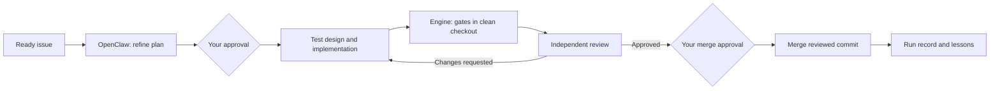

<div align="center">

# devflow

**From GitHub issue to reviewed pull request.**

Repository-aware engineering workflows, orchestrated with OpenClaw and executed by the coding agents you already use.

[](https://github.com/Rishik-J/devflow/actions/workflows/ci.yml)
[](https://www.python.org/)
[](LICENSE)

[Website](https://rishik-j.github.io/devflow/) · [Get started](#quick-start) · [Setup guide](docs/getting-started.md) · [Local tracing](#local-traces-and-workflow-metrics) · [Architecture](DESIGN.md) · [Contributing](CONTRIBUTING.md)

</div>

---

Devflow turns a GitHub Project into an engineering queue. OpenClaw refines requirements, asks clarifying questions and decides how to handle stalled work. Claude Code, Codex or Cursor implement changes in isolated git worktrees. An independent reviewer checks the result, while the engine runs tests, records state and controls GitHub writes.

Plans and merges require your approval by default. After a run, devflow captures evidence-backed lessons and makes relevant context available to later agents.

**Status:** early-stage software, version 0.1.0. The single-ticket workflow has been exercised on a real repository; queue execution, stop conditions and failure paths have automated integration coverage. Start with small tickets and review the generated plans and diffs.

## Why devflow

- **A repeatable ticket loop.** Refine → plan approval → test design → implement → verify → review → merge approval.
- **Context from the repository.** Detect projects, test commands and conventions during initialization. Graphify provides a local code graph, changed-file relationships and agent context.
- **Multiple coding agents.** Use Claude Code, Codex and Cursor through their terminal CLIs, with session resume and configurable usage-based routing.
- **Independent verification.** Run gates in a separate checkout, compare failures against the base commit, and return review findings to the coder.
- **Durable progress.** SQLite records transitions, artifacts and sessions so interrupted tickets can resume.
- **Bounded execution.** Review caps, run limits, exclusive repo ownership and a STOP file keep the loop manageable.
- **Local observability in one command.** Start the bundled Langfuse stack with Docker to inspect prompts, responses, exposed tool calls, agent handoffs, review loops and recorded usage. Traces stay on your machine, with credential redaction and persistent storage.
- **Repository learning.** Keep lessons with ticket evidence, select them by role and file scope, and publish context updates through pull requests.

## How it works



The engine owns state transitions, tests, commits, pushes and merges. Agents supply judgment through validated responses. The merge is pinned to the commit that was reviewed; an unexpected branch update blocks it.

## Requirements

| Component | Purpose |
|---|---|
| Python 3.11+ and [uv](https://docs.astral.sh/uv/getting-started/installation/) | Install and run devflow |
| Git | Isolated worktrees and branches |
| [GitHub CLI](https://cli.github.com/) | Issues, Projects, PRs and CI status |
| [OpenClaw](https://github.com/openclaw/openclaw) | Planning, triage and retrospective agents |
| [Graphify](https://github.com/Graphify-Labs/graphify) | Local code graph and graph queries |
| At least one coding-agent CLI | Claude Code (`claude`), Codex (`codex`) or Cursor (`agent`) |

macOS and Linux are supported targets. Install and authenticate your selected agent CLIs before running tickets. Two coding tools are recommended so the reviewer can use a different tool from the coder. Devflow does not include model subscriptions or API credits.

## Quick start

### 1. Install

```bash
uv tool install "git+https://github.com/Rishik-J/devflow.git"
uv tool install graphifyy
```

Devflow is installed from this repository; there is no official PyPI release documented here.

### 2. Connect GitHub and OpenClaw

```bash
gh auth login
gh auth refresh -h github.com -s project

# Start your configured OpenClaw gateway if it is not already running.
openclaw gateway
```

Run the gateway in a separate terminal, or use your existing OpenClaw service. In another terminal:

```bash
# Choose a provider/model supported by your OpenClaw installation.
openclaw models list
devflow setup-openclaw --model YOUR_PROVIDER/YOUR_MODEL
devflow doctor
```

`setup-openclaw` creates the dedicated `devflow` agent once. If it already exists, the command leaves it in place; change its model through OpenClaw when needed. Model credentials remain in the underlying tools.

### 3. Initialize a target repository

```bash
cd /path/to/your/repo
devflow init
```

Your target must be a git repository with a GitHub remote and an initial commit for ticket execution. Review `.devflow/config.toml`, especially the environment setup and test commands, before your first run.

### 4. Create the Project queue

```bash
devflow board-create --title "Engineering queue"
gh label create devflow --color 0e8a16 --description "Worked by devflow" --force
```

Create a small issue, give it the `devflow` label, add it to the Project and set its Status to **Ready**. The generated Project has Backlog, Ready, In progress, In review and Done, plus P0–P3 priorities.

### 5. Preview and run

```bash
devflow board
devflow run --dry-run

devflow run --watch 20 --max-tickets 3 --max-minutes 60 --max-cost-usd 5
```

The queue resumes existing tickets and processes eligible Ready issues. It pauses at human gates, continues with other eligible work, and polls for your replies in watch mode.

For a single issue:

```bash
devflow ticket 12 --watch 20
```

## Human approvals

Reply in GitHub with one of these comments. Only configured approvers count; by default, that is the authenticated `gh` user.

| Comment | Where | Effect |
|---|---|---|
| `/approve` | Issue | Accept the proposed plan, or clarification defaults |
| `/answer …` | Issue | Answer a clarification |
| `/reject …` | Issue | Request a revised plan |
| `/approve` | PR | Authorize merge after review and CI checks |
| `/resume` | Issue | Resume an escalated ticket |
| `/learn gotcha: …` | Issue or PR | Record a human-confirmed lesson |

An approval is consumed once. An issue-level plan approval does not authorize the later merge.

## Autonomous queue with OpenClaw supervision

For a trusted repository, you can let the dedicated OpenClaw agent review plans and pull
requests while devflow enforces tests, CI and the reviewed commit before merging. The queue
stops after every three merged tickets and sends one checkpoint with completed work and
suggested next tickets. A reply of `continue` from the owner resumes the queue. This is an
opt-in mode; the default human approval gates above remain enabled.

Set these values in the target repository's `.devflow/config.toml`:

```toml
[human_gates]
plan_approval = false
merge_approval = false
notify_command = "openclaw agent --agent devflow --deliver --reply-channel imessage --reply-to YOUR_IMESSAGE_HANDLE --message {text}"

[agents]
planner = "openclaw:devflow"
reviewer = "openclaw:devflow"
triage = "openclaw:devflow"
retro = "openclaw:devflow"
```

The reviewer independently checks the proposed plan and may send it back for revision.
It then reviews the implementation diff and gate evidence. Devflow still refuses to merge
when CI fails, when the reviewed branch changes, or when engine gates fail. Clarification
questions and escalations still pause the affected ticket.

Run `devflow run --max-tickets 3 --max-minutes 60` in the repository. For unattended
operation, create one OpenClaw Automation per repository:

```bash
openclaw automations add --name "Devflow queue" --every 2m \
  --command "devflow run --max-tickets 3 --max-minutes 60 /path/to/repo" \
  --command-cwd /path/to/repo --command-env "PATH=$PATH" \
  --timeout-seconds 0 --no-deliver
```

The explicit `PATH` lets the job find OpenClaw and the coding-agent CLIs even when the
Gateway starts with a reduced environment. The queue
uses a repository lock, so overlapping invocations cannot work the same ticket. When the
three-ticket checkpoint arrives, reply `continue` to an OpenClaw agent configured to run
`devflow continue /path/to/repo`; the next scheduled run picks up the queue. You can also
run that command yourself. The checkpoint is stored locally in `.devflow/state/` and
survives process restarts. In autonomous mode, the next run asks OpenClaw to select up to
three eligible follow-up issues from Backlog and moves those issues to Ready. The engine
checks the returned issue numbers against the actual Project items before changing status.

Use `.devflow/STOP` to pause further work at stage boundaries. Keep your iMessage handle
and other personal notification settings in your local config, outside public commits.

## Configure each repository

`devflow init` generates the following files:

```text
.devflow/
├── config.toml             # Agents, gates, limits and Project settings
├── context/repo-brief.md    # Shared repository context
├── prompts/                # Role instructions tuned to the repository
└── schemas/                # Structured plan, test, review and lesson contracts
```

It detects Python, Node.js, Rust and Go projects, including monorepos. Detection is a starting point: fill in missing integration commands and verify setup commands. Existing files are preserved; `init --force` replaces generated files, including customized configuration.

Commit the shareable `.devflow` files. Graph caches and `.devflow/state/` remain local through git excludes installed by initialization.

Important settings include:

```toml
[human_gates]
plan_approval = true
merge_approval = true
approvers = ["your-github-login"]

[review]
require_integration = true

[learning]
enabled = true
promote_after = 2
budget_chars = 4000
```

These are excerpts to edit in the generated file, not extra tables to append. Setting `require_integration = true` blocks review until at least one integration gate is configured. The default is `false`.

See the [setup guide](docs/getting-started.md) for gate configuration, an existing Project, routing and troubleshooting.

## Code graph and learning

Graphify builds a graph on first use in each checkout. The engine checks freshness before agent requests and rebuilds when the source fingerprint changes. AST graph updates run locally without an LLM; the agent providers still receive the context used for model calls.

```bash
devflow graph status
devflow graph refresh
devflow graph context --files src/example.py
devflow graph impact src/example.py --depth 2 --format json

devflow learn list
devflow learn retro 12
devflow learn approve L-xxxxxxxx
devflow learn reject L-xxxxxxxx
devflow learn publish
```

`graph impact` is deterministic and makes no LLM calls. Its report has the keys `files`, `unknown_files`, `depth`, `graph_state`, `symbols`, `callers` (by hop), `dependent_modules`, `external_contracts`, `test_coverage` and `uncovered`.

Agent lessons begin as candidates. They become active after independent evidence from two tickets, or explicit human approval. Active lessons are selected by role and file scope for later prompts. Publishing opens a context-update PR containing only the repo brief and lesson ledger.

Context PRs distribute a reviewable snapshot; local lesson approval affects local runs immediately. Graphify MCP tools are injected for Claude and Codex. Cursor receives the context digest, and OpenClaw receives the checkout path and graph-query instructions.

### Planner ego-network slice

At plan time devflow matches file paths and symbol names in the ticket title and body against the code graph and gives the planner a 1-2 hop slice around them: callers, dependencies and the tests that exercise them. The planner is told to name affected callers and integration contracts in `risks` and list caller/test files in step `files`. Only graph-derived labels and paths are rendered (never the ticket text), and the slice is capped at about 3000 characters. If the graph is missing, unreadable or nothing matches, nothing is added and planning proceeds as before. The trace root records `slice_status` (`injected` or `unavailable`), `slice_seeds` and `slice_nodes`.

## Execution controls

```bash
devflow tickets
devflow agents
devflow stats

# From the target repository:
touch .devflow/STOP
# Remove the file when ready to resume, then run devflow again.
```

STOP and run limits are checked between stages. A running stage can finish, so time and cost ceilings can overshoot by a stage. Cost tracking uses reported cost or token estimates and excludes unmetered OpenClaw calls; it is not a billing guarantee. `--max-cost-usd 0`, the default, disables that ceiling.

The default run limits are ten distinct tickets and sixty minutes. A lock shared by a repository's worktrees prevents concurrent queue and single-ticket execution. No daemon is installed automatically.

`devflow run --dry-run` previews queue selection without model calls. `devflow ticket N --dry-run` is different: it can call agents and create temporary local worktrees, but logs GitHub writes instead of performing them.

## Local traces and workflow metrics

**Understand every stage of the ticket loop with local Langfuse tracing.** The Docker setup
ships with devflow, so everyone cloning the repo can start the same observability stack with
one command. No Langfuse Cloud account or hosting subscription is needed.

| Inspect | What you can learn |
|---|---|
| Prompts, role instructions, repository context and responses | What context each agent received and what it returned |
| Agent handoffs and exposed tool inputs/outputs | How planning, implementation and review passed work between agents |
| Review findings, fixes, validation errors and gate output | Why a change failed verification or needed another round |
| Stage timings, retries, routing decisions and available token/cost data | Where time and recorded usage went |
| Ticket sessions across resumed runs | How a ticket progressed through approvals, retries and completion |

From your devflow source checkout:

```bash
# From this source checkout; Docker handles credentials and all observability services:
./scripts/observability up --capture-content /absolute/path/to/your/repo

# Then run devflow normally in that repository:
cd /absolute/path/to/your/repo
devflow telemetry demo
devflow telemetry metrics
devflow telemetry metrics --issue 12   # per-ticket latency summary
```

`telemetry metrics` reports per-stage latency as `count`, `mean`, `max`, `p50`, `p90` and `p99`, plus `stage_stalls`: how often a finished stage exceeded the p99 of its own history (see [docs/observability.md](docs/observability.md)).

The setup image, Compose stack and tracing integration are included in this repository.
Anyone cloning devflow gets the same setup; only Docker with Compose v2 is needed to start
observability. Run `./scripts/observability up` to connect the devflow checkout itself, or
supply multiple repository paths. Credentials are generated uniquely on each machine.

Open [localhost:3300](http://localhost:3300); local credentials are in
`infra/langfuse/login.json` in the devflow checkout. Add `--capture-content` to record redacted
prompts, responses, tool payloads and review artifacts; omit it for metadata-only capture in a
new repository. Existing capture settings are preserved. Named Docker volumes retain traces.
Manage the stack from the devflow checkout:

```bash
./scripts/observability status
./scripts/observability logs
./scripts/observability stop
```

Stopping the stack preserves traces and account data. Re-running `up` reuses existing local
credentials. For multiple target repos, pass their paths after `--capture-content`.

Capture follows what each CLI exposes: private OpenClaw internals are unavailable, reconstructed
CLI events are labelled, and oversized content is explicitly truncated. Usage and costs may be
partial or estimated. See the guide for the capture boundaries.

Devflow and its authenticated coding agents run on the host; this Docker bundle supplies
observability. See the [observability guide](docs/observability.md) for setup, replay, scope
and cost-accounting details.

## Development

```bash
git clone https://github.com/Rishik-J/devflow.git
cd devflow
uv tool install --editable .

uv run --no-project --with ruff ruff check .
uv run --no-project --with pytest --with-editable . python -m pytest -q
```

Most tests use temporary git repositories and fake agents. Live tests are opt-in, require authenticated CLIs and incur model usage:

```bash
DEVFLOW_LIVE=1 uv run --no-project --with pytest --with-editable . \
  python -m pytest tests/test_live_agents.py -q
```

See [CONTRIBUTING.md](CONTRIBUTING.md) for the development workflow and [DESIGN.md](DESIGN.md) for the architecture and original implementation plan.

## Landing page

The public site lives at [rishik-j.github.io/devflow](https://rishik-j.github.io/devflow/).
Its source is plain HTML, CSS, JavaScript and locally served brand assets in `site/`; no
frontend framework or runtime dependencies are needed. The homepage shows the workflow
graph and an illustrative ticket animation. Brand asset sources are listed in
[`site/brands/README.md`](site/brands/README.md). Preview from the repository root:

```bash
python3 -m http.server 8000 --bind 127.0.0.1 --directory site
```

Open [localhost:8000](http://localhost:8000). Stop the server with Ctrl-C.

To enable hosting, a repository maintainer must choose **Settings → Pages → Build and
deployment → Source → GitHub Actions**. The `Deploy landing page` workflow stamps CSS
and JavaScript URLs with a content hash using `scripts/version_site_assets.py`, then
uploads only `site/`. This prevents a new HTML page from loading an older cached
stylesheet or script.

The workflow deploys after changes to the site, versioning script or workflow land on
`main`; pull requests do not deploy. If environment protection rules are configured,
allow `main` in the `github-pages` environment. The first successful workflow run
makes the site available.
Keep product copy aligned with the README, setup guide and architecture when behavior changes.

## License

[MIT](LICENSE) © 2026 Rishik J.
